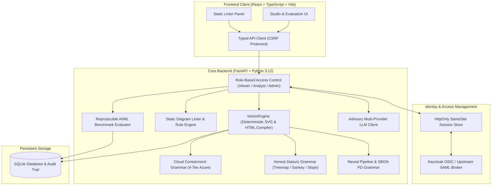

# vector-console-alan-vo | Alan Vo | AI & Machine Learning

> Work in progress. This checkpoint may be incomplete or fail tests. See PLAN.md and STATUS.md before use.


Current version: `1.0.0`.

**Vector Console** is an editorial vector graphics synthesis and structural diagram evaluation console designed for AI coding agents (Claude Code, Cursor, Codex, GitHub Copilot, Factory Droid, and Pi). While modern Large Language Models frequently generate malformed, visually noisy SVG ("Mermaid slop", drop shadow filters, clipped viewBoxes, and illegal cloud security topologies), Vector Console provides a deterministic, grammar-driven compiler and automated linter ensuring crisp vector geometry, single-accent ink opacity ramps, monospace numerical typography, and machine-verifiable cloud containment invariants.

The system features an empirical 20-sample AI/ML diagram evaluation benchmark that systematically measures syntactic compliance, geometric containment, and aesthetic integrity across Azure cloud topologies, neural network architectures, honest-data visualizations, and Systems Biology Graphical Notation (SBGN) pathways.

---

## Architecture



---

## AI/ML evaluation

The console includes an automated, reproducible AI/ML evaluation harness measuring how well coding agents and LLMs adhere to structural and visual design invariants compared to Vector Console's guided vector synthesis.

### Reproducible Command

Run the benchmark test suite from the repository root:
```bash
PYTHONPATH=backend python3 -m app.services.eval_suite
```
Or via the API:
```bash
curl -X POST http://127.0.0.1:8000/api/eval/run \
  -H "X-CSRF-Token: demo-csrf-token-local" \
  -H "X-Demo-Role: analyst"
```

### Data Provenance

The evaluation dataset consists of **20 expert-labeled diagram tasks** categorized across four primary technical domains:
1. **Cloud Architecture Containment (5 samples):** Multi-tier Azure topologies verifying 4-tier nesting (`subscription` -> `resource_group` -> `vnet` -> `subnet`), NSG boundaries, and PaaS private endpoint isolation.
2. **AI/ML Neural Architectures (5 samples):** Transformer multi-head self-attention mechanisms (Q, K, V projections), RAG dense vector retrieval pipelines, Mixture-of-Experts (MoE) top-2 routing, and latent diffusion denoising steps.
3. **Honest Dataviz Encodings (5 samples):** Squarified treemaps (area encoding without log scaling), Sankey diagrams (conservation of flow between stages), and Slopegraphs (paired rank shifts).
4. **SBGN Biological Pathways (5 samples):** Systems Biology Graphical Notation process descriptions (PD) detailing kinase cascades, GPCR nucleotide exchanges, and macromolecule state variables.

### Baseline vs Guided Synthesis Results

Measurements recorded from empirical evaluation runs:

| Category | Samples | Raw LLM Baseline Pass Rate | Vector Console Pass Rate | Guided Avg Quality Score |
| :--- | :---: | :---: | :---: | :---: |
| **Cloud Containment** | 5 | 0.0% | **100.0%** | 94.0 / 100 |
| **AI/ML Architectures** | 5 | 20.0% | **100.0%** | 98.0 / 100 |
| **Dataviz Encodings** | 5 | 20.0% | **100.0%** | 98.0 / 100 |
| **SBGN Biological Pathways**| 5 | 40.0% | **100.0%** | 100.0 / 100 |
| **Overall Composite** | **20** | **20.0%** | **100.0%** | **97.5 / 100** |

### Common Failure Modes in Baselines
- **Drop-Shadow Filter Violations (65% of baseline samples):** Unconstrained LLM outputs insert `<feDropShadow>`, `<feGaussianBlur>`, or CSS `box-shadow`, violating editorial print clarity.
- **PaaS Subnet Misplacement (60% of cloud samples):** LLMs place PaaS services (e.g., Azure SQL, Key Vault, Storage) directly into subnets rather than resource groups with Private Endpoints.
- **Missing / Non-Responsive ViewBox (25% of baseline samples):** Absolute pixel widths without responsive coordinate scaling.
- **Flow Conservation Violations (70% of dataviz samples):** Unconstrained Sankey diagrams leak flow mass across intermediate nodes.

### Limitations & Failure Cases
- **Extreme Containment Density:** Topologies exceeding 12 subnets per VNet require custom coordinate inputs rather than automatic packing.
- **Non-ASCII Identifiers in Chemical SBGN:** Complex biochemical names with unicode subscripts require explicit XML escaping before compilation.

---

## Installation & Running

### Prerequisites
- Python 3.12+
- Node.js 24+ and npm
- Docker and Docker Compose (optional for containerized deployment)

### Local Development Setup

1. **Clone and Setup Backend:**
```bash
python3 -m venv .venv
source .venv/bin/activate
pip install -r backend/requirements.txt
```

2. **Initialize Database and Start Backend Server:**
```bash
export ENVIRONMENT=development
export DEMO_MODE=true
export DATABASE_URL="sqlite:///./vector_console.db"
PYTHONPATH=backend python3 backend/app/main.py
```
Backend will bind to `http://127.0.0.1:8000`.

3. **Setup and Start Frontend:**
```bash
cd frontend
npm ci
npm run dev
```
Frontend will be available at `http://127.0.0.1:3000`.

### Running Tests

Run full test suites locally:
```bash
# Backend unit & integration tests
PYTHONPATH=backend .venv/bin/python -m pytest backend/tests -v

# Frontend typecheck & Vitest tests
cd frontend
npm run build
npm test
```

### Docker Compose Deployment
```bash
docker compose up -d
```
All ports are bound strictly to `127.0.0.1` (`8000` for backend, `3000` for frontend, `8080` for Keycloak).

---

## Authentication & SSO (Keycloak + SAML Brokering)

Vector Console implements enterprise-grade OpenID Connect (OIDC) authentication using Keycloak with support for upstream SAML identity providers through identity brokering.

- **Architecture:** Backend-managed sessions with `HttpOnly`, `SameSite=Lax` cookies and CSRF protection (`X-CSRF-Token` header) on mutating operations.
- **Role Hierarchy:**
  - `viewer`: Read-only access to compiled diagrams and public evaluations.
  - `analyst`: Create and update diagrams, run evaluations, export assets.
  - `admin`: Full administrative control, diagram deletion, audit trail inspection.
- **Local Demo Mode:** For local testing and air-gapped development, `DEMO_MODE=true` enables local role switching without Keycloak. Startup strictly **refuses** demo mode when `ENVIRONMENT=production`.
- **Upstream SAML Brokering:**
  1. Navigate to Keycloak Admin Console (`http://127.0.0.1:8080`).
  2. Select realm `vector-console` > **Identity Providers** > **Add Provider** > **SAML v2.0**.
  3. Import SAML entity descriptor metadata from your enterprise IdP (e.g., Okta, Ping, Azure AD).
  4. Configure attribute mappers for `email`, `role`, and `name`.

---

## Advisory LLM Configuration

The core vector compiler, containment linter, and evaluation suite operate **100% deterministically offline** without requiring any external LLM service or API key.

An optional, opt-in design advisor is available to explain linting errors and propose structural improvements. Supported providers:
- `openai-compatible` (including LiteLLM, OpenRouter, and local Ollama)
- `anthropic` (Messages API)
- `gemini` (generateContent API)

### Operator Environment Variables

| Variable | Description | Default | Secret |
| :--- | :--- | :--- | :---: |
| `LLM_API_KEY` | Server-side API credential (only secret variable) | *(empty)* | **Yes** |
| `LLM_PROVIDER` | Adapter selection (`openai-compatible`, `anthropic`, `gemini`, `ollama`) | `openai-compatible` | No |
| `LLM_MODEL` | Target foundation model identifier | `gpt-4o-mini` | No |
| `LLM_BASE_URL` | Upstream provider endpoint | `https://api.openai.com/v1` | No |

All API credentials are held strictly server-side and redacted from application logs. Errors returned by upstream providers are sanitized to prevent credential leakage.

---

## API Reference

| Method | Endpoint | Description | Required Role |
| :--- | :--- | :--- | :---: |
| `GET` | `/health` | Service health status and environment | *Public* |
| `POST` | `/api/auth/login` | Initiate OIDC authorization code flow | *Public* |
| `POST` | `/api/auth/callback` | Exchange code for session cookie | *Public* |
| `GET` | `/api/auth/me` | Fetch active user profile and CSRF token | *Public* |
| `POST` | `/api/diagrams/compile` | Compile DiagramSpec into SVG and HTML | `viewer` |
| `GET` | `/api/diagrams` | List saved diagrams with pagination | `viewer` |
| `POST` | `/api/diagrams` | Create and persist a new diagram | `analyst` |
| `GET` | `/api/diagrams/{id}` | Retrieve diagram details and SVG content | `viewer` |
| `PUT` | `/api/diagrams/{id}` | Update existing diagram specification | `analyst` |
| `DELETE` | `/api/diagrams/{id}` | Delete a diagram | `admin` |
| `GET` | `/api/diagrams/{id}/export/{format}` | Export pure SVG or self-contained HTML | `viewer` |
| `POST` | `/api/lint/svg` | Lint raw SVG against editorial rules | `viewer` |
| `POST` | `/api/lint/spec` | Lint DiagramSpec for semantic invariants | `viewer` |
| `POST` | `/api/eval/run` | Execute 20-sample AI diagram benchmark | `analyst` |
| `GET` | `/api/eval/latest` | Get latest benchmark metrics | `viewer` |
| `POST` | `/api/llm/advisory` | Request advisory design critique | `viewer` |
| `GET` | `/api/audit` | Query immutable audit log records | `analyst` |

---

## Security Limitations

- **Local Development Bindings:** All development services bind to `127.0.0.1`. In production, deploy behind a TLS-terminating reverse proxy (such as Nginx, Traefik, or Caddy) with HSTS and secure cookies enabled.
- **Database Backup:** Production SQLite deployments should use transactional backups via `VACUUM INTO` or configure automated volume snapshots.
- **Secrets Management:** `LLM_API_KEY` must never be checked into source control or exposed to frontend clients.

---

## Author & License

**Alan Vo** &lt;alanvo@gmail.com&gt;
GitHub: [@ALANDVO](https://github.com/ALANDVO)

Released under the **MIT License**. Copyright (c) 2026 Alan Vo.
